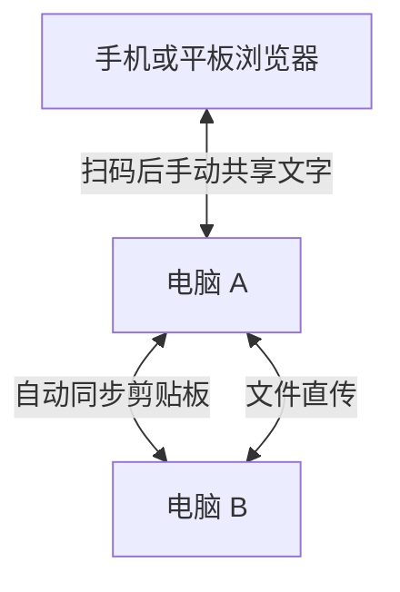

# MeshShare

换到另一台电脑时，刚复制的链接、命令或截图常常还留在原来的设备上。MeshShare 让 Windows、macOS 和 Ubuntu 电脑在局域网里共享剪贴板。

在 Windows 上复制链接，切到 Mac 就能直接粘贴。要把手机里的文字发给电脑，扫描桌面端的二维码，在网页里编辑后就能同步。

## 项目特点

- **桌面剪贴板自动同步。** 电脑之间共享文字和图片，图片以 PNG 同步。
- **手机和平板扫码加入。** iPhone、iPad 和 Android 设备直接使用浏览器，按需查看、编辑和同步共享文字。
- **每台电脑都能独立提供共享服务。** 同一局域网内的电脑自动发现彼此。断开互联网时仍可共享，无需账号或单独部署服务器。
- **文件直传。** 把文件或文件夹拖到目标设备卡片，或点击「选择文件」「选择文件夹」。接收方在「传输任务」中确认并选择保存目录，文件直接写入目标电脑。

## 安装

前往发布页，在最新版本的 **Assets** 中下载对应系统和架构的安装包，安装后打开 MeshShare。桌面构建面向 Windows x64、macOS Intel 和 Apple Silicon、Ubuntu x64。具体安装包以发布页为准。[GitHub Releases](https://github.com/yangjinming1062/MeshShare/releases/latest)

正式安装包默认开启开机自启动。登录系统后 MeshShare 会在后台托盘运行，主窗口不会自动弹出；打开主窗口后可在顶部关闭或恢复这一设置。

正式桌面版本默认每周检查 GitHub 稳定版 Release，可在主窗口的「客户端自动更新」中切换为每天或关闭。发现更新后会在没有进行中的文件传输时自动安装并重启。

## 快速上手

1. **找到另一台电脑。** 将两台电脑接入同一受信任的局域网并启动 MeshShare。在「在线设备」里确认对方已经出现。
2. **试一次跨设备粘贴。** 确认发送端显示「自动同步中」，复制一段文字，在另一台电脑上粘贴。也可以在「共享剪贴板」里编辑文字，再点「立即同步当前文字」。
3. **用手机或平板扫码。** 在电脑端找到「手机扫码访问」，选一个移动设备可访问的地址，再扫描二维码。在网页的「共享剪贴板」里粘贴或编辑文字，点「同步到设备」。要把电脑上的文字带到手机，可以在同一个文本框里选中文字并复制。浏览器允许时，也可使用「读取手机剪贴板」和「写入手机剪贴板」。

关闭主窗口后，MeshShare 仍在系统托盘运行。开机自启动也使用这一后台托盘模式；硬件监控悬浮条首次启动时位于主显示器右下角，使用半透明紧凑布局显示本机 CPU、GPU、显存、内存和网络速率，并继续遵循已经保存的监控显示模式。未锁定时可直接拖动，主界面硬件监控卡片可以锁定或解锁悬浮条。托盘可隐藏硬件监控悬浮条，也可通过「退出程序」停止共享。在设备卡片上点击「查看监控」，可以查看对方电脑的实时指标。

## 已知限制

- **网络。** 节点服务无需账号或配对，只绑定本机回环、RFC1918 私网、链路本地和 Tailscale 组网地址；二维码和 `/api/v1/info` 只公布实际监听且仍有效的地址，手动连接也拒绝公网主机，公网 IPv4/IPv6 不会被监听或展示。可达的受信任设备可以访问共享内容，请不要把节点端口转发到互联网。
- **剪贴板。** MeshShare 仅保留最新的共享内容。Ubuntu 使用 Wayland 时，自动同步取决于 XWayland 和桌面环境的剪贴板桥接。移动网页的系统剪贴板按钮需要浏览器授权和安全上下文。
- **文件。** 接收目录由本机 Tauri 文件选择器确认，任务状态由 Rust 节点保留到进程退出。手机扫码后可以确认并下载发送到该扫码节点的文件；手机会话空闲 90 秒后临时目录清理，节点启动时也会清理上次遗留目录，每个手机会话最多预留 5 GiB 临时空间。发送端当前选择的 `File` 对象仍由窗口持有；关闭窗口前未上传完的文件需要重新选择。

## 开发与项目文档

- [开发指南](docs/DEVELOPMENT.md)
- [产品设计](docs/DESIGN.md)
- [系统架构](docs/ARCHITECTURE.md) · [架构图谱](docs/ARCHITECTURE_MAP.md) · [通信协议](docs/PROTOCOL.md)
