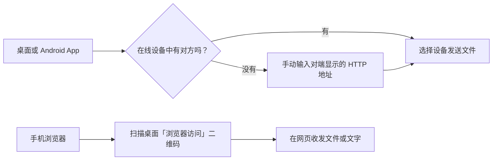
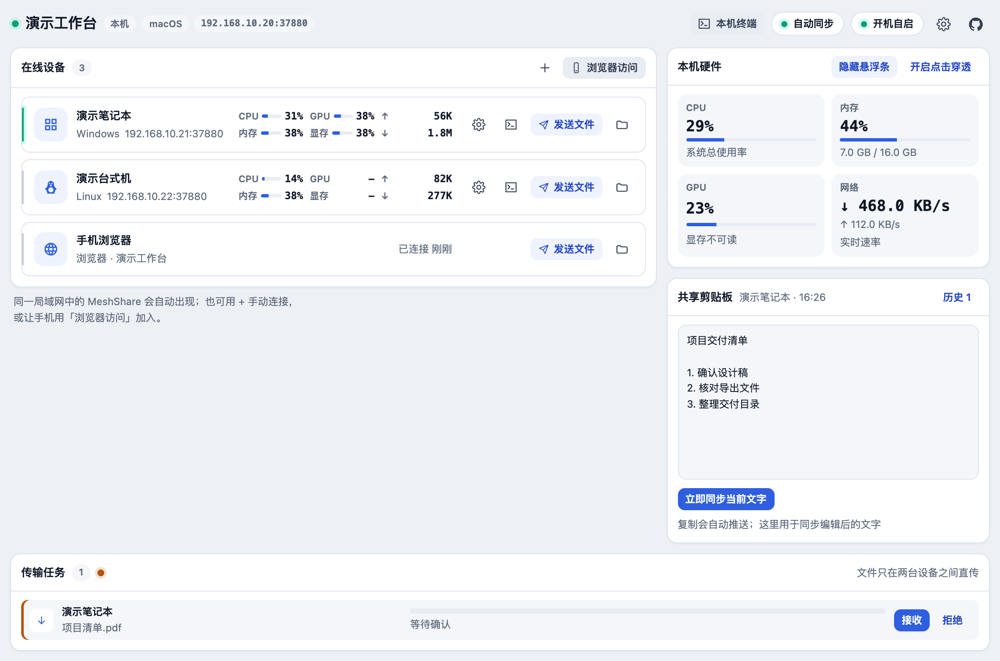
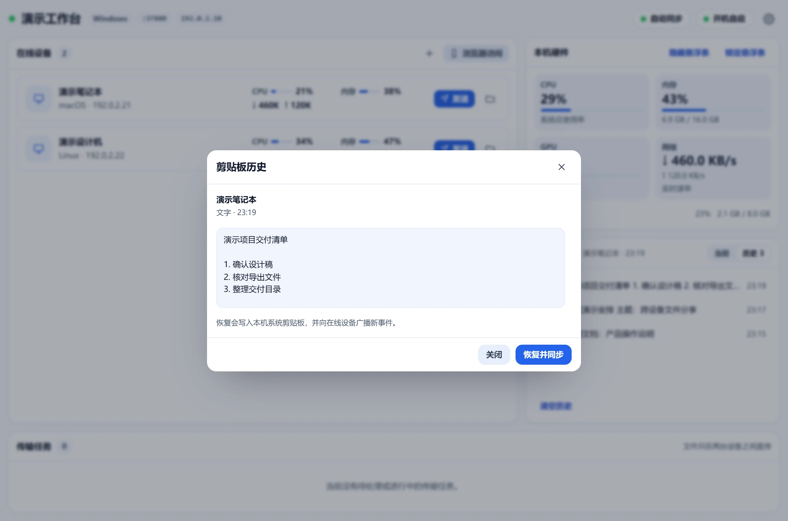

  
  <h1>MeshShare</h1>
  
在一台电脑复制，在另一台粘贴。通过可信局域网或 Tailscale 直接传文件，不需要账号、网盘或中央服务器。

  

## 可以做什么

| 场景 | 怎么用 |
| --- | --- |
| 换台电脑继续工作 | 复制文字或截图，在另一台在线电脑直接粘贴；也可以搜索本机剪贴板历史，预览后恢复。 |
| 把整个目录交给同事 | 把文件或文件夹拖到设备卡片。接收方确认目录或启用自动接收；按文件校验 SHA-256，不覆盖同名文件，失败可重试。 |
| 用手机临时收发 | 打开 Android App，或用浏览器扫节点二维码；手动发送文字、上传或接收文件。 |
| 查看另一台机器 | 设备列表显示 CPU、内存、GPU 和网速。进入目标节点可查看详情、调整设置；经目标本机授权后，还能让它从自己的磁盘发送文件。 |

## 选择使用方式

| | 桌面节点 | Android App | 浏览器 |
| --- | --- | --- | --- |
| 运行方式 | Windows、macOS、Linux；托盘常驻、可开机自启 | 打开 App 时运行节点 | 打开在线节点的地址即可，无需安装 |
| 剪贴板 | 自动同步文字与图片 | 手动读写文字 | 手动同步文字，系统剪贴板受浏览器权限限制 |
| 文件接收 | 选择目录或设为自动接收 | 应用专属目录，授权后可用公共下载目录 | HTTP 逐项下载；受信任的 HTTPS 页面在浏览器支持时可选目录 |
| 硬件监控 | 本机与对端详情、桌面悬浮条 | 查看对端详情，本机提供网速 | 不采集本机硬件 |

## 安装与首次连接

从 [GitHub Releases](https://github.com/yangjinming1062/MeshShare/releases/latest) 的「下载指导」选择对应系统和芯片的安装包。启动后，按设备类型连接：

桌面之间无需先选设备：连接后在一端复制文字，即可在另一端粘贴。跨局域网可用 Tailscale；手动连接以对端显示的端口为准，默认是 `37880`。

**只在可信网络使用。** 同网可达不等于经过身份验证。节点间 HTTP/WebSocket 为明文，浏览器 HTTPS 不保护节点间链路。不要向公网转发节点端口。

## 界面一览

| 搜索并恢复剪贴板 | 确认接收文件 | 手机浏览器 |
| :---: | :---: | :---: |
|  |  |  |

[使用指南与平台限制](docs/DESIGN.md) · [源码构建与验证](docs/DEVELOPMENT.md) · [维护导航](AGENTS.md) · [MIT 许可证](LICENSE)
