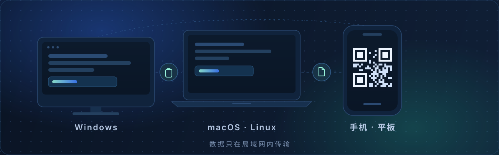
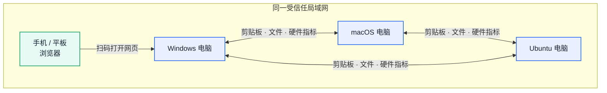
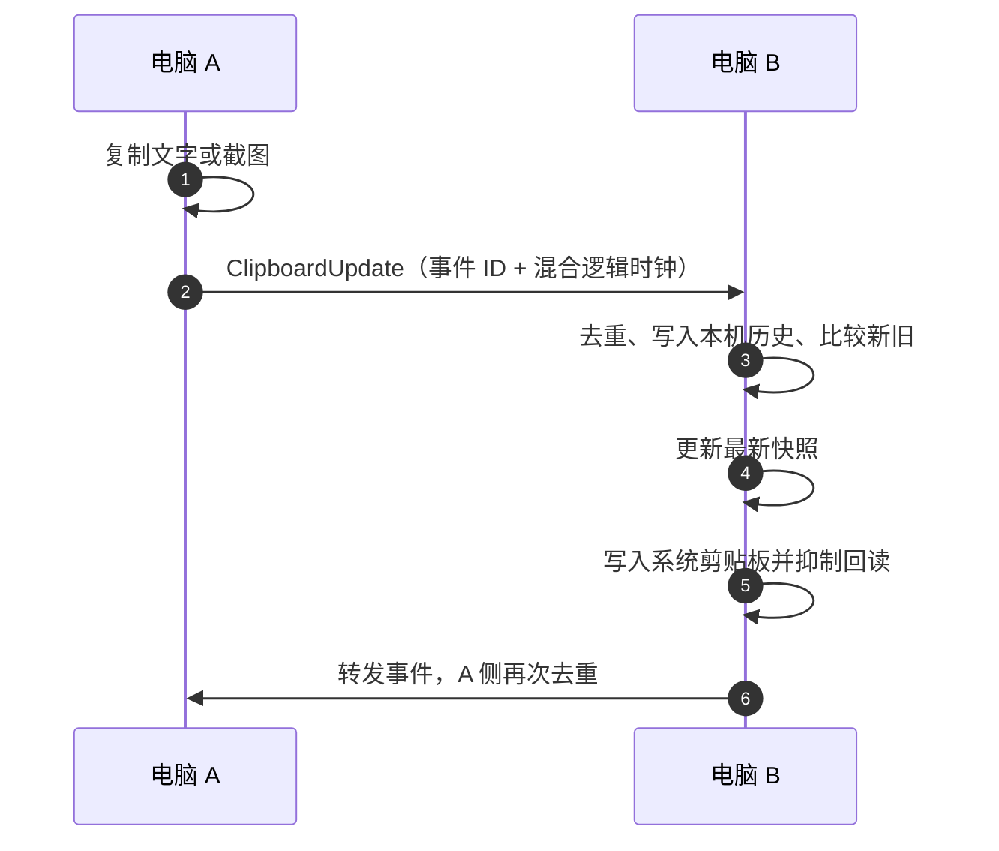
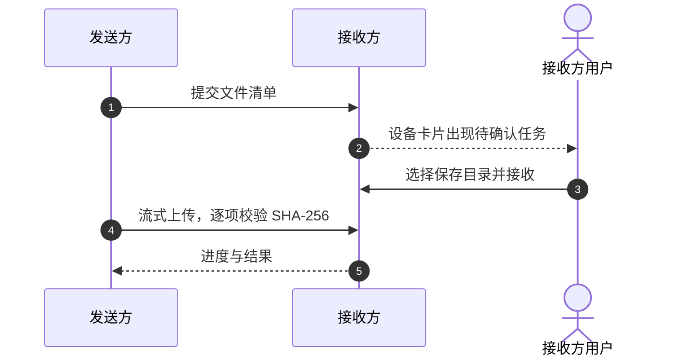

<div align="center">
  
  <h1>MeshShare</h1>
  <p><b>局域网里的剪贴板与文件直传，不需要账号，也不需要服务器。</b></p>
  <p>在 Windows 上复制的链接，切到 Mac 直接粘贴；手机扫一下码，文字和文件就能进出电脑。</p>
  <p>
    <a href="https://github.com/yangjinming1062/MeshShare/releases/latest"></a>
    
    
    <a href="LICENSE"></a>
  </p>
</div>

<div align="center">
  
</div>

## 它解决什么问题

换到另一台电脑时，刚复制的链接、命令或截图常常还留在原来的设备上。发给自己要登录，传网盘要上传下载，用聊天软件又会留下记录。

MeshShare 把这一步还原成最自然的动作：复制，走过去，粘贴。每台装了 MeshShare 的电脑都是一个独立节点，启动后在局域网内自动发现彼此，直接同步剪贴板和收发文件。没有中心服务器，没有账号；断网时只要还在同一网络里就能继续用。手机和平板不必安装应用，扫码打开网页即可临时加入。

| 场景 | 以前 | 使用 MeshShare |
| --- | --- | --- |
| 另一台电脑要用刚复制的链接 | 发给自己，或存进网盘 | 复制后在另一台直接粘贴 |
| 手机里的长文字要进电脑 | 聊天软件转存，或手动输入 | 扫码，在网页里编辑并同步 |
| 给旁边的电脑传一个文件夹 | 压缩、上传、再下载 | 拖到对方的设备卡片，直接写入对方磁盘 |

## 功能

- **剪贴板自动同步。** 在任意一台电脑复制文字或截图，其他在线电脑的系统剪贴板随即更新，切过去直接粘贴。图片按 PNG 同步，文字与图片单项上限 16 MiB。每台机器还会独立保存本机看到的历史内容，可按最近条数或最近天数配置并从历史中恢复；节点用混合逻辑时钟比较新旧并对事件去重，可以暂停本机采集与发布，暂停期间仍接收其他设备的内容。
- **设备自动发现。** 同一局域网内的节点通过 mDNS 自动出现在「在线设备」中，无需填写 IP。自动发现不可用时，可以输入完整地址手动连接，例如 `http://192.168.1.10:37880`；端口默认 `37880`，被占用时自动改用空闲端口。
- **手机和平板扫码即用。** 桌面端列出本机可访问的局域网与 Tailscale 地址并生成二维码，手机用浏览器打开就能查看设备、编辑并同步文字，也可以收发文件。浏览器允许时还能直接读写手机剪贴板。
- **文件与文件夹直传。** 把文件或文件夹拖到对方设备卡片，或点「选择文件」「选择文件夹」。接收方在「传输任务」中确认并选择保存目录，内容从发送方直接写入目标电脑：逐项校验 SHA-256，同名文件不会被覆盖。
- **硬件状态。** 每秒采集一次 CPU、内存、网络速率与 GPU/显存，主窗口可以查看本机和对端的实时指标，超过 5 秒没有更新会标记为过期。首次启动在主显示器右下角显示半透明悬浮条，位置会记住；未锁定时可拖动，锁定后鼠标点击穿透。
- **常驻托盘。** 关闭主窗口只是隐藏，节点、同步与托盘继续运行。正式安装包默认开启开机自启动，登录系统后静默进入托盘；重复打开应用只激活已有窗口。
- **签名自动更新。** 正式版本默认每周检查 GitHub Release，也可以改为每天或关闭。发现新版本后，会在没有进行中的传输时下载、校验签名、安装并重启；传输进行中则等待任务结束。

## 工作方式

MeshShare 没有中心服务器：每台电脑都同时是服务端和客户端，启动后各自监听本机地址、通过 mDNS 互相发现，并用 WebSocket 保持长连接。节点服务负责 HTTP、WebSocket、发现、传输状态、剪贴板历史与临时文件；桌面外壳负责窗口、托盘和系统剪贴板；手机网页连接扫码的那台节点，读取设备列表和共享内容。



### 剪贴板同步

剪贴板事件带事件 ID 和混合逻辑时钟：接收方按 ID 和内容去重，把唯一内容写入本机历史；只有 HLC 更新的事件才替换当前系统剪贴板并继续转发。由此产生的回读变化会被抑制，不会再次广播。历史只在本机保存，节点之间的 WebSocket 仍只交换最新快照。



### 文件直传

接收方确认之前不会开放上传。确认后，每个文件先写入目标目录里的 `.part` 临时文件，校验大小与 SHA-256，再用不可覆盖的方式提交为最终文件名。



## 技术栈

| 组成 | 实现 |
| --- | --- |
| 桌面外壳 | Tauri 2：主窗口、硬件监控悬浮条、系统托盘、单实例、文件选择器与签名自动更新 |
| 节点服务 | Rust：axum（HTTP / WebSocket）、mdns-sd（发现）、arboard（剪贴板）、sysinfo 与平台接口（硬件指标） |
| 界面 | Svelte 5 + TypeScript + Vite，桌面窗口与手机网页共用同一份前端 |
| 发布 | GitHub Actions 构建 Windows、macOS、Linux 安装包，并生成 Tauri updater 清单与签名 |

## 安装

从 [GitHub Releases](https://github.com/yangjinming1062/MeshShare/releases/latest) 下载对应系统的安装包，安装后直接启动。

| 系统 | 架构 | 安装包 |
| --- | --- | --- |
| Windows | x64 | `.exe`（NSIS）· `.msi` |
| macOS | Apple Silicon · Intel | `.dmg` |
| Linux | x64 | `.AppImage` · `.deb` · `.rpm` |

正式安装包默认开启开机自启动，登录系统后以托盘模式运行，可在主窗口中关闭。正式版本默认每周检查一次更新，也可以改成每天或关闭。若 macOS 提示无法验证开发者，可在「系统设置 → 隐私与安全性」中允许运行。

## 快速上手

1. **让两台电脑互相发现。** 两台电脑都安装并启动 MeshShare，接入同一局域网；使用 Tailscale 时保持组网在线。设备会自动出现在「在线设备」中，未出现时可输入完整地址手动连接。
2. **验证一次跨设备粘贴。** 确认发送端显示「自动同步中」，复制一段文字，在另一台电脑上粘贴。也可以在「共享剪贴板」里编辑文字，再点「立即同步当前文字」。
3. **查看剪贴板历史。** 在共享剪贴板的历史列表中选择一条内容预览，点击「恢复并同步」即可重新写入本机系统剪贴板并同步给在线设备；桌面端可在历史设置中选择按条数或按天数保留。
4. **让手机加入。** 在「手机扫码访问」里选择手机能访问的地址，扫描二维码，在网页的「共享剪贴板」里粘贴或编辑文字，点「同步到设备」，也可以浏览扫码节点保存的历史并显式恢复。
5. **传一个文件。** 把文件或文件夹拖到对方的设备卡片，接收方在「传输任务」中确认并选择保存目录。

## 安全与隐私

MeshShare 的内容只在设备之间传递，不经过任何中转服务器，也不会上传到云端。节点只监听本机回环、RFC1918 私网、链路本地与 Tailscale 组网地址，二维码和手动连接同样限制在这些地址，公网 IPv4/IPv6 不会被监听。

代价是：服务使用明文 HTTP / WebSocket，没有账号也没有令牌，网络内可达的设备可以直接读写共享内容。请只在受信任的网络中使用，不要把节点端口转发到互联网。

## 已知限制

- **剪贴板。** 每台机器独立保存历史，默认可保留最近 50 条或最近 30 天，桌面端可在 1–500 条和 1–365 天范围内配置；文字与 PNG 图片单项均不超过 16 MiB，历史不设额外总容量上限。Ubuntu 使用 Wayland 时，同步依赖 XWayland 与桌面环境的剪贴板桥接。手机网页的系统剪贴板按钮需要浏览器授权，普通 HTTP 页面通常只能用文本框手动复制粘贴。
- **文件。** 接收目录必须由本机文件选择器确认，同名文件不会被覆盖；任务状态保存在进程内存，退出后清空。发送端选中的文件由窗口持有，关闭窗口前未完成的上传需要重新选择；单个传输任务最多 4096 项、合计 5 GiB。
- **手机接收。** 接收会话只在扫码节点上有效，空闲 90 秒后清理任务与临时文件，节点启动时也会清理上次遗留目录；每个会话最多预留 5 GiB 临时空间。

## 开发

需要 Rust 1.90 或更高（含 `rustfmt`、`clippy`）、Node.js 22 和对应平台的 Tauri 依赖。

```bash
npm --prefix web ci
npm --prefix web run build
npx --yes @tauri-apps/cli@2 dev -- --locked
```

提交前在仓库根目录运行 `npm --prefix web run check`，并在 `src-tauri/` 下运行 `cargo fmt --check`、`cargo clippy -- -D warnings` 与 `cargo test`。完整环境、构建与发布流程见 [开发指南](docs/DEVELOPMENT.md)。

## 项目文档

- [开发指南](docs/DEVELOPMENT.md)：环境准备、启动、构建与发布
- [产品设计](docs/DESIGN.md)：体验目标、用户可见行为与使用边界
- [系统架构](docs/ARCHITECTURE.md)：模块边界、状态权威与信任边界
- [架构图谱](docs/ARCHITECTURE_MAP.md)：节点拓扑、同步序列与部署
- [通信协议](docs/PROTOCOL.md)：HTTP 接口、WebSocket 消息与传输约束

## 参与贡献

欢迎提交 Issue 和 Pull Request。参与开发前请阅读 [RULES.md](RULES.md) 与 [开发指南](docs/DEVELOPMENT.md)，并按其中的代码、文档和验证要求提交改动。

## 许可证

[MIT License](LICENSE) © 2026 MeshShare
