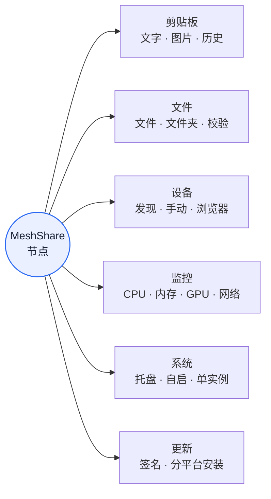
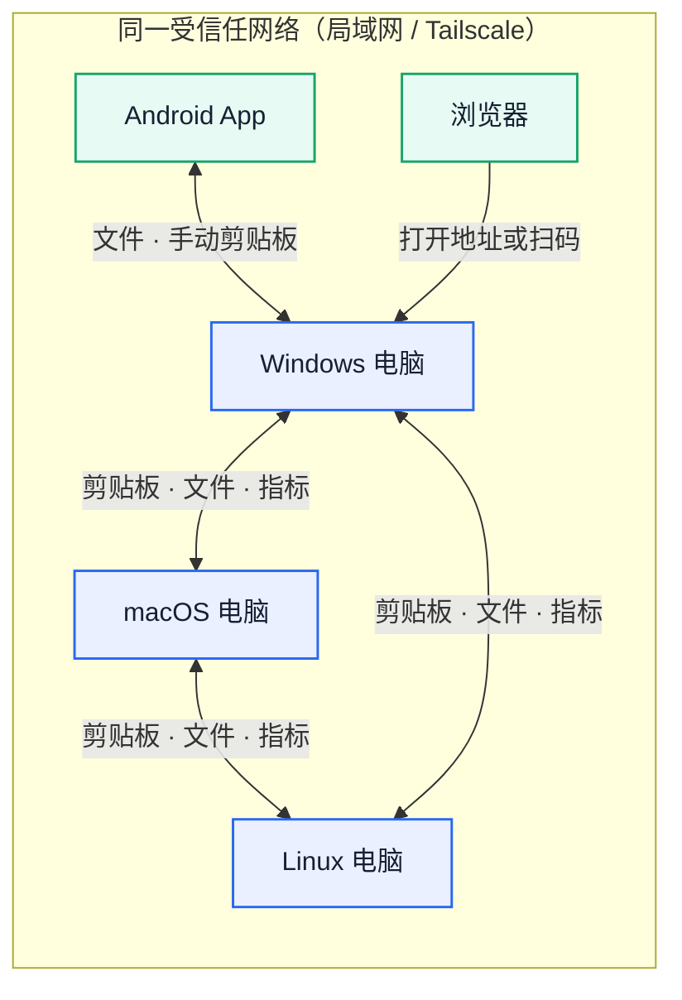
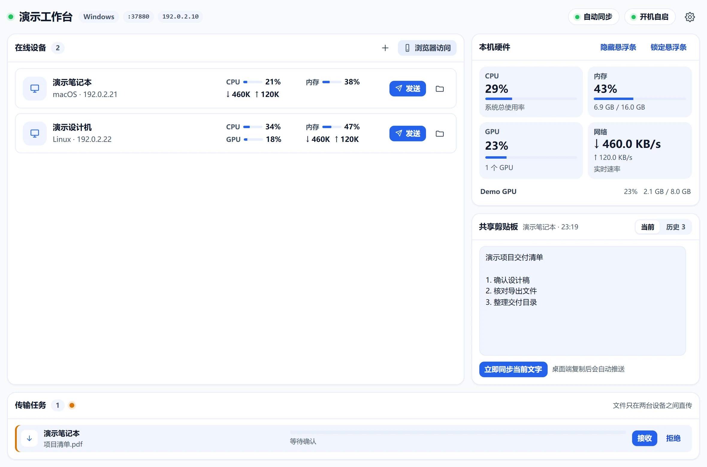

<div align="center">
  
  <h1>MeshShare</h1>
  <p><b>局域网里的剪贴板与文件传输，不需要账号，也不需要中央服务器。</b></p>
  <p>在 Windows 上复制的链接，切到 Mac 直接粘贴；Android App 打开后即可在局域网内收发文件和文字。</p>
  <p>
    <a href="https://github.com/yangjinming1062/MeshShare/releases/latest"></a>
    
    
    <a href="LICENSE"></a>
  </p>
</div>

<div align="center">
  
</div>

## 它解决什么问题

复制，走过去，粘贴。每台装了 MeshShare 的电脑和打开中的 Android App 都是节点，直接收发文字、图片、文件和文件夹；浏览器打开节点地址也能临时加入。没有中心服务器，也没有账号。

| 场景 | 以前 | 使用 MeshShare |
| --- | --- | --- |
| 另一台电脑要用刚复制的链接 | 发给自己，或存进网盘 | 复制后在另一台直接粘贴 |
| 手机里的长文字要进电脑 | 聊天软件转存，或手动输入 | 打开 Android App，编辑后手动同步 |
| 给旁边的电脑传一个文件夹 | 压缩、上传、再下载 | 拖到对方的设备卡片，直接写入对方磁盘 |

## 功能



| 分类 | 能力 | 说明 |
| --- | --- | --- |
| 剪贴板 | 自动同步 | 桌面复制文字或截图，其他在线电脑的系统剪贴板随即更新，切过去直接粘贴。 |
| 剪贴板 | 历史与恢复 | 每台机器独立保存文字与 PNG；桌面与浏览器可预览并恢复，桌面直接写回系统剪贴板。 |
| 剪贴板 | 暂停与手动 | 桌面可暂停本机采集与发布；Android 和浏览器手动读取、编辑、发布、写回。 |
| 剪贴板 | 图片查看 | 当前与历史图片按整宽显示，点击放大。 |
| 设备 | 自动发现 | 同网节点通过 mDNS 出现在「在线设备」，无需填写地址。 |
| 设备 | 手动连接 | 自动发现不可用时输入 `http://地址:37880`，并保存最近连接。 |
| 设备 | 浏览器加入 | 「浏览器访问」生成地址与二维码；HTTP 零安装，HTTPS + 本地 CA 可选目录直写；加入后窗口自动收起。 |
| 设备 | 远程管理 | 点击设备进入一层远程上下文，剪贴板、历史、设置、硬件和传输都在目标节点执行。 |
| 文件 | 文件与文件夹 | 拖到设备卡片或选择文件/文件夹，接收方确认后由发送节点直接写入目标磁盘。 |
| 文件 | 完整性校验 | 每项 SHA-256，先写 `.part` 再不可覆盖提交，同名文件不会被覆盖。 |
| 文件 | 接收策略 | 每次确认或自动接收；默认目录失效时回退人工确认。 |
| 文件 | 传输历史 | 最近 10 条终态记录跨重启保留；清空时同步删除对端配对记录。 |
| 文件 | 失败重试 | 失败任务可按递增代次重试，已提交项目不重复传输。 |
| 文件 | 远程发送 | 在目标机器目录里选择文件，由目标机器读取并直传，管理端不接触内容。 |
| 文件 | 网页收发 | HTTP 页面逐项下载；HTTPS 页面选目录流式写入；上传使用分块哈希。 |
| 监控 | 实时采集 | 每秒采集 CPU、内存、交换分区、网络、磁盘、GPU/显存及系统信息。 |
| 监控 | 对端详情 | 设备行显示对端 CPU、内存、GPU 与上下行速率，点击查看完整快照。 |
| 监控 | 悬浮条 | 半透明悬浮条显示本机指标，可拖动、锁定点击穿透、隐藏，位置随配置保存。 |
| 系统 | 托盘常驻 | 关闭主窗口只隐藏；Windows 左键双击托盘图标切换显隐。 |
| 系统 | 开机自启 | 正式安装包默认开启，登录后静默进入托盘；重复启动只激活已有窗口。 |
| 更新 | 桌面自动更新 | 默认每周检查；等待传输结束再安装；Linux 系统包需系统授权；支持本机更新代理。 |
| 更新 | Android 更新 | App 内检查、下载并交给系统安装，关闭 App 后不保留连接。 |

## 设计

几个取舍决定了产品的形态。

| 设计 | 做法 | 得到 | 代价 |
| --- | --- | --- | --- |
| 无中心服务器 | 每个节点同时是服务端和客户端，mDNS 发现 + WebSocket 长连接。 | 内容不经过第三方，断网仍可用。 | 两端必须网络可达。 |
| 状态归本机 | 历史、设置、接收策略与传输状态由各自节点持有，远程管理只下发操作。 | 一台离线不影响其他设备。 | 没有统一账户或云端视图。 |
| 内容直传 | 发送节点在接收方确认后流式上传，逐项校验后提交。 | 不经中转，进度与重试可恢复。 | 发送端需保持在线。 |
| 无账号 | 以受信任网络为边界，只监听回环、私网、链路本地与 Tailscale 地址。 | 零配置、零注册。 | 同网设备可访问共享内容。 |
| 冲突收敛 | 事件带 ID 与混合逻辑时钟，按内容去重，回读不二次广播。 | 多设备来回同步不产生风暴。 | 只交换最新快照，不合并历史。 |
| 能力协商 | `Hello` 声明能力，旧节点只参与支持的子集。 | 新旧版本可以共存。 | 新功能要求对端升级。 |



### 一次复制


历史只在本机保存，节点之间只交换最新快照。

### 一次传文件


接收方确认之前不会开放上传。

## 界面

桌面主窗口同时显示在线设备、共享剪贴板、传输任务与本机硬件摘要；手机或平板用浏览器打开节点地址即可加入，版式自动切换为单列。

<p align="center"></p>

<p align="center"><sub>桌面主窗口：设备、剪贴板、本机硬件与传输任务同屏。</sub></p>

<p align="center"></p>

<p align="center"><sub>剪贴板历史：先预览，再「恢复并同步」。</sub></p>

<p align="center"></p>

<p align="center"><sub>传输任务：接收方确认后才开始写入。</sub></p>

<p align="center"></p>

<p align="center"><sub>手机浏览器：单列版式，每台设备自带发送入口。</sub></p>

## 平台支持

● 完整　◐ 受限　○ 手动　— 不提供

| 能力 | Windows | macOS | Linux | Android | 浏览器 |
| --- | --- | --- | --- | --- | --- |
| 剪贴板自动同步 | ● | ● | ● | ○ | ○ |
| 剪贴板历史、恢复与清空 | ● | ● | ● | — | ● |
| 接收文件 | ● | ● | ● | ● | ◐ |
| 发送文件 | ● | ● | ● | ● | ● |
| 发送文件夹 | ● | ● | ● | — | ◐ |
| 硬件采集与详情 | ● | ● | ● | ◐ | — |
| 悬浮监控条 | ● | ● | ◐ | — | — |
| 托盘与开机自启 | ● | ● | ● | — | — |
| 应用内自动更新 | ● | ● | ● | ● | — |

Android 只采集并发布网络上下行速率，桌面节点的完整硬件快照仍可在 App 内查看。浏览器在手机等窄屏上只提供文件发送，文件夹发送需要更宽的页面。

## 安装

从 [GitHub Releases](https://github.com/yangjinming1062/MeshShare/releases/latest) 下载对应系统的安装包，安装后直接启动。

| 系统 | 架构 | 安装包 |
| --- | --- | --- |
| Windows | x64 | `.exe`（NSIS）· `.msi` |
| macOS | Apple Silicon · Intel | `.dmg` |
| Linux | x64 | `.AppImage` · `.deb` · `.rpm` |
| Android | arm64（推荐） | `.apk`（Release）· `.aab`（商店/本地构建） |

Android 下载 `MeshShare_<版本>_android_arm64.apk`，按系统提示允许浏览器或文件管理器安装；旧版用户覆盖安装一次带「应用更新」入口的版本后即可在 App 内更新。AAB 用于应用商店或 `bundletool`。正式桌面安装包默认开机自启并在后台检查更新。

<details>
<summary>macOS 首次打开提示「已损坏」或「无法验证开发者」</summary>

当前 Release 是 ad-hoc 签名包，没有 Apple Developer ID 公证。按芯片选择 `aarch64.dmg`（Apple Silicon）或 `x64.dmg`（Intel），双击 DMG 把 `MeshShare.app` 拖到「应用程序」，首次打开后到「系统设置 → 隐私与安全性」点「仍要打开」。如果没有出现该按钮，确认安装包来自 GitHub Releases 后执行：

```bash
xattr -dr com.apple.quarantine "/Applications/MeshShare.app"
open "/Applications/MeshShare.app"
```

不要用 `spctl --master-disable` 关闭整台 Mac 的 Gatekeeper。设备发现依赖同一局域网的 mDNS；列表为空时先确认其他节点已启动并在同一网络，再手动输入 `http://设备地址:37880`。局域网隔离时需要允许 UDP 5353（mDNS）和 TCP 37880。

</details>

## 快速上手

1. 两台电脑都安装并启动 MeshShare，接入同一局域网；使用 Tailscale 时保持组网在线。
2. 在一台电脑复制文字，到另一台直接粘贴；也可以在「共享剪贴板」编辑后点「立即同步当前文字」。
3. 在共享剪贴板的历史里选择一条预览，点「恢复并同步」写回本机并广播给在线设备。
4. 点「浏览器访问」生成地址或二维码，用手机、平板或其他电脑打开即可临时加入。
5. 把文件或文件夹拖到对方的设备卡片，接收方确认保存位置后开始传输。

## 安全与隐私

| 主题 | 说明 |
| --- | --- |
| 数据路径 | 内容只在设备之间传递，无中转、无云端上传。 |
| 监听范围 | 只监听回环、RFC1918 私网、链路本地与 Tailscale 地址；公网地址不会被监听，也不会放进二维码。 |
| 传输加密 | 节点之间是明文 HTTP/WebSocket；HTTPS + 本地 CA 只保护浏览器到节点这一段。 |
| 访问控制 | 没有账号和令牌，以受信任网络为边界；远程文件访问默认关闭，只能在本机界面开启。 |
| 使用前提 | 只在自己信任的网络里使用，不要把节点端口转发到互联网。 |

## 已知限制

| 项目 | 限制 | 处理 |
| --- | --- | --- |
| 剪贴板单项 | 文字与 PNG 各不超过 16 MiB；图片解码另有 8192×8192 与 128 MiB 上限。 | 超限内容不会发布。 |
| 历史容量 | 默认最近 50 条或 30 天，可调 1–500 条 / 1–365 天；payload 默认不超过 512 MiB。 | 达到上限优先清理最旧记录。 |
| Wayland | 不保证全局坐标、强制置顶和点击穿透；原生剪贴板协议不可用时回退 XWayland。 | 共享、历史和文件传输不受影响。 |
| 浏览器剪贴板 | 需要安全上下文与浏览器授权；HTTP 页面通常只能手动复制粘贴。 | 安装 CA 后改用 HTTPS。 |
| 网页接收 | 会话只在接入节点有效，空闲 90 秒后清理任务与临时文件。 | 重新打开页面。 |
| 传输记录 | 活动任务只在运行期间保留；最近 10 条终态历史跨重启保留，失败记录保留 20 条、最长 24 小时。 | 退出前完成未结束的传输。 |
| 浏览器上传 | 文件由页面的 `File` 对象提供，关闭页面后未完成的上传需要重新选择。 | 桌面与 Android 由节点读取，不受影响。 |
| Android | 关闭 App 即停止节点；不自动监听剪贴板；VPN 锁定非局域网流量时设备发现可能为空。 | 手动连接，或让两端走 Tailscale。 |
| AppImage | 首次运行前需要 `chmod +x`，不能与系统包版本同时运行。 | 先从托盘退出系统包版本。 |

## 技术栈

| 组成 | 实现 |
| --- | --- |
| 桌面与 Android 外壳 | Tauri 2：主窗口、监控悬浮条、系统托盘、单实例，以及 Android 按需节点窗口 |
| 节点服务 | Rust：axum（HTTP / WebSocket）、mdns-sd（发现）、arboard（桌面剪贴板）、sysinfo 与平台接口（硬件指标） |
| 界面 | Svelte 5 + TypeScript + Vite，桌面窗口、网页端与 Android 共用同一份前端 |
| 发布 | GitHub Actions 构建签名的桌面和 Android 安装包并生成更新清单，Android AAB 可本地构建 |

## 开发

需要 Rust 1.90 或更高（含 `rustfmt`、`clippy`）、Node.js 22 和对应平台的 Tauri 依赖。

```bash
npm --prefix frontend ci
npm --prefix frontend run build
npx --yes @tauri-apps/cli@2 dev -- --locked
```

提交前在仓库根目录运行 `npm --prefix frontend run check`，并在 `backend/` 下运行 `cargo fmt --check`、`cargo clippy -- -D warnings` 与 `cargo test`。完整环境、构建与发布流程见 [开发指南](docs/DEVELOPMENT.md)。

## 项目文档

| 文档 | 内容 |
| --- | --- |
| [开发指南](docs/DEVELOPMENT.md) | 环境准备、启动、构建、发布与验收 |
| [产品设计](docs/DESIGN.md) | 体验目标、用户可见行为与使用边界 |
| [系统架构](docs/ARCHITECTURE.md) | 模块边界、状态权威与信任边界 |
| [架构图谱](docs/ARCHITECTURE_MAP.md) | 节点拓扑、同步序列与部署 |
| [通信协议](docs/PROTOCOL.md) | HTTP 接口、WebSocket 消息与传输约束 |

## 参与贡献

欢迎提交 Issue 和 Pull Request。参与开发前请阅读 [RULES.md](RULES.md) 与 [开发指南](docs/DEVELOPMENT.md)，并按其中的代码、文档和验证要求提交改动。

## 许可证

[MIT License](LICENSE) © 2026 MeshShare
