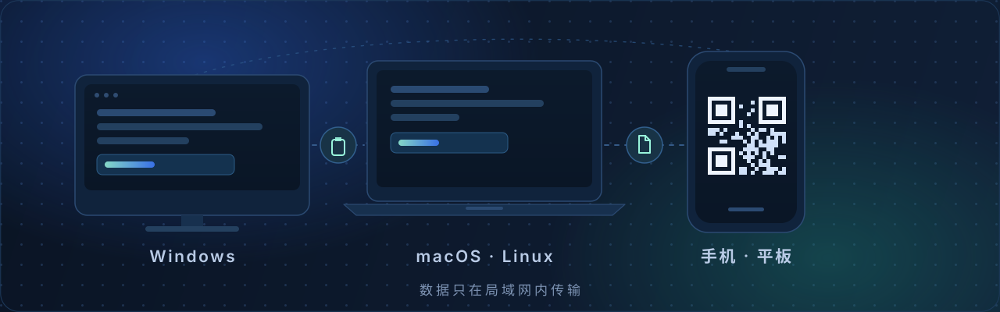
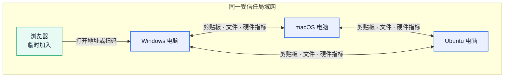
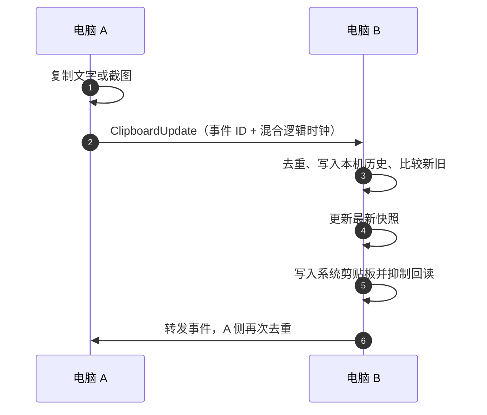
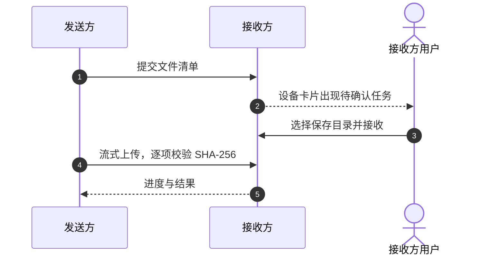

<div align="center">
  
  <h1>MeshShare</h1>
  <p><b>局域网里的剪贴板与文件传输，不需要账号，也不需要中央服务器。</b></p>
  <p>在 Windows 上复制的链接，切到 Mac 直接粘贴；Android App 打开后即可在局域网内收发文件和文字。</p>
  <p>
    <a href="https://github.com/yangjinming1062/MeshShare/releases/latest"></a>
    
    
    <a href="LICENSE"></a>
  </p>
</div>

<div align="center">
  
</div>

## 它解决什么问题

换到另一台电脑时，刚复制的链接、命令或截图常常还留在原来的设备上。发给自己要登录，传网盘要上传下载，用聊天软件又会留下记录。

MeshShare 把这一步还原成最自然的动作：复制，走过去，粘贴。每台装了 MeshShare 的电脑和打开中的 Android App 都可以作为局域网节点，直接收发文件和文字。没有中心服务器，没有账号；断网时只要还在同一网络里就能继续用。其他设备不必安装应用，用浏览器打开节点地址即可临时加入。

| 场景 | 以前 | 使用 MeshShare |
| --- | --- | --- |
| 另一台电脑要用刚复制的链接 | 发给自己，或存进网盘 | 复制后在另一台直接粘贴 |
| 手机里的长文字要进电脑 | 聊天软件转存，或手动输入 | 打开 Android App，编辑后手动同步 |
| 给旁边的电脑传一个文件夹 | 压缩、上传、再下载 | 拖到对方的设备卡片，直接写入对方磁盘 |

## 界面

桌面主窗口同时显示在线设备、共享剪贴板、传输任务与本机硬件摘要；手机或平板用浏览器打开节点地址即可加入，版式自动切换为单列。

<p align="center"></p>

<p align="center"><sub>桌面主窗口：在线设备行带对端硬件摘要，右侧是共享剪贴板与本机硬件，底部是传输任务。</sub></p>

<p align="center"></p>

<p align="center"><sub>共享剪贴板历史：先预览内容，再选择「恢复并同步」写回本机系统剪贴板。</sub></p>

<p align="center"></p>

<p align="center"><sub>传输任务：待接收的文件显示发送方与文件名，接收方确认后才开始写入。</sub></p>

<p align="center"></p>

<p align="center"><sub>手机浏览器加入：单列版式，每台设备自带发送入口，共享文字可以直接同步。</sub></p>

## 功能

- **剪贴板自动同步。** 在任意一台电脑复制文字或截图，其他在线电脑的系统剪贴板随即更新，切过去直接粘贴；文字与 PNG 图片单项上限 16 MiB。每台机器独立保存本机看到的历史，可以从历史中恢复，也可以暂停本机采集与发布，暂停期间仍接收其他设备的内容。
- **设备自动发现。** 同一局域网内的节点通过 mDNS 自动出现在「在线设备」中，无需填写 IP。自动发现不可用时，可以输入完整地址手动连接，例如 `http://192.168.1.10:37880`；端口默认 `37880`，被占用时自动改用空闲端口。
- **浏览器临时加入。** 桌面端列出本机可访问的局域网与 Tailscale 地址并生成二维码；在电脑、手机或平板的浏览器打开该地址（手机也可以扫码）就能查看设备、编辑并同步文字，也可以收发文件。浏览器允许时还能直接读写本机剪贴板。
- **Android App 按需接入。** App 记住最近连接的节点，打开后自动发现或直接连接局域网地址，不需要每次扫码，也不要求安装桌面节点的本地 CA；可以双向传输文件，查看桌面节点的硬件指标，并显示本机上下行流量。开启普通全隧道 VPN 时，只要 Wi‑Fi 或以太网仍可用，App 会优先使用物理局域网保持设备发现和连接；Tailscale 组网继续使用 Tailscale 网络。剪贴板不在后台自动监听，但打开 App 后可以手动读取、编辑、发布和写入共享内容。
- **文件与文件夹传输。** 把文件或文件夹拖到对方设备卡片，或点「选择文件」「选择文件夹」。同一局域网中的桌面节点和 Android 节点由发送方直接写入目标节点；在远程管理页面向其他设备发送时，文件会经当前接入节点流式转发，不建立持久化中转仓库。接收方在「传输任务」中确认并选择保存目录，逐项校验 SHA-256，同名文件不会被覆盖。
- **硬件状态。** 每秒采集一次 CPU、内存、交换分区、网络速率、磁盘容量和 GPU/显存，并补充 CPU 型号、核心数、频率、系统负载和运行时间；主窗口可以查看本机和对端的实时指标，超过 5 秒没有更新会标记为过期。首次启动在主显示器右下角显示半透明悬浮条，位置会记住；未锁定时可拖动、右键菜单锁定或隐藏，锁定后鼠标点击穿透，锁定和显示都可在托盘或主界面切换。
- **常驻托盘。** 关闭主窗口只是隐藏，节点、同步与托盘继续运行。Windows 下左键双击系统托盘图标即可在显示和隐藏主窗口之间切换，其他桌面平台继续通过托盘菜单操作；正式安装包默认开启开机自启动，登录系统后静默进入托盘；重复打开应用只激活已有窗口。
- **签名自动更新。** 正式版本默认每周检查 GitHub 稳定版，也可以改为每天或关闭。更新会等待当前文件传输完成。桌面端在后台更新并重启，Android App 打开期间可在应用内下载和安装更新，按系统提示授权或确认即可；Ubuntu 以 `.deb`/`.rpm` 安装时会在本机弹出系统授权确认，取消后保留待更新并可稍后重试。AppImage 更新不需要授权，首次运行前要执行 `chmod +x`，并且不能与正在运行的系统包版本同时启动。

## 工作方式

MeshShare 没有中心服务器：每台电脑都同时是服务端和客户端，启动后各自监听本机地址、通过 mDNS 互相发现，并用 WebSocket 保持长连接。节点服务负责 HTTP、WebSocket、发现、传输状态、剪贴板历史与临时文件；桌面外壳负责窗口、托盘和系统剪贴板；网页端连接打开地址的那台节点，读取设备列表和共享内容。



### 剪贴板同步

剪贴板事件带有事件 ID 和混合逻辑时钟：接收方按 ID 和内容去重，把新内容写入本机历史，只有更新的内容才替换系统剪贴板并继续转发，由此产生的回读变化不会再次广播。历史只在本机保存，节点之间只交换最新快照。



### 文件传输

接收方确认之前不会开放上传。普通节点传输确认后，每个文件先写入目标目录里的 `.part` 临时文件，校验大小与 SHA-256，再用不可覆盖的方式提交为最终文件名。远程管理页面发送文件时，管理端把文件流交给当前接入节点，由它通过已有节点连接转发到目标设备；接入节点只保留运行期间的流和状态，不保存中央文件副本。



## 技术栈

| 组成 | 实现 |
| --- | --- |
| 桌面与 Android 外壳 | Tauri 2：桌面主窗口、硬件监控悬浮条、系统托盘，以及 Android 按需节点窗口 |
| 节点服务 | Rust：axum（HTTP / WebSocket）、mdns-sd（发现）、arboard（桌面剪贴板）、sysinfo 与平台接口（硬件指标） |
| 界面 | Svelte 5 + TypeScript + Vite，桌面窗口与网页端共用同一份前端 |
| 发布 | GitHub Actions 构建签名的桌面和 Android 安装包并生成更新清单，Android AAB 可本地构建 |

## 安装

从 [GitHub Releases](https://github.com/yangjinming1062/MeshShare/releases/latest) 下载对应系统的安装包，安装后直接启动。

| 系统 | 架构 | 安装包 |
| --- | --- | --- |
| Windows | x64 | `.exe`（NSIS）· `.msi` |
| macOS | Apple Silicon · Intel | `.dmg` |
| Linux | x64 | `.AppImage` · `.deb` · `.rpm` |
| Android | arm64（推荐） | `.apk`（Release）· `.aab`（商店/本地构建） |

Android 用户在 Release 页面下载 `MeshShare_<版本>_android_arm64.apk`。大多数近年 Android 手机选择 arm64，首次安装时按系统提示允许浏览器或文件管理器安装应用。旧版用户覆盖安装一次带「应用更新」入口的版本即可保留设置和数据，后续可以直接在 App 内更新。AAB 用于应用商店或 `bundletool`。

正式桌面安装包默认开机自启并在后台检查更新。

### macOS 安装与首次打开

当前 GitHub Release 提供的是 ad-hoc 签名包，没有 Apple Developer ID 公证。它可以正常运行 MeshShare 的设备发现、剪贴板和文件传输功能，但 macOS 首次打开时可能显示「MeshShare 已损坏，无法打开」或「无法验证开发者」。

1. 在「关于本机」确认芯片：Apple Silicon 下载 `aarch64.dmg`，Intel 下载 `x64.dmg`。
2. 双击 DMG，将 `MeshShare.app` 拖到「应用程序」文件夹。
3. 首次打开后，到「系统设置 → 隐私与安全性」，在“安全性”区域点击「仍要打开」，再确认打开。
4. 如果没有出现「仍要打开」，确认 DMG 来自 [GitHub Releases](https://github.com/yangjinming1062/MeshShare/releases/latest) 后，在终端执行：

   ```bash
   xattr -dr com.apple.quarantine "/Applications/MeshShare.app"
   open "/Applications/MeshShare.app"
   ```

不要使用 `spctl --master-disable` 关闭整台 Mac 的 Gatekeeper。设备自动发现依赖同一局域网的 mDNS；如果列表为空，可先确认其他节点已启动并在同一网络，再展开「手动连接设备」输入 `http://设备地址:37880`。局域网隔离时需要允许 UDP 5353（mDNS）和 TCP 37880（节点连接）。

## 快速上手

1. **让两台电脑互相发现。** 两台电脑都安装并启动 MeshShare，接入同一局域网；使用 Tailscale 时保持组网在线。设备会自动出现在「在线设备」中，未出现时可输入完整地址手动连接。
2. **验证一次跨设备粘贴。** 确认发送端显示「自动同步中」，复制一段文字，在另一台电脑上粘贴。也可以在「共享剪贴板」里编辑文字，再点「立即同步当前文字」。
3. **查看剪贴板历史。** 在共享剪贴板的历史列表中选择一条内容预览，点击「恢复并同步」即可重新写入本机系统剪贴板并同步给在线设备；桌面端可在历史设置中选择按条数或按天数保留。
4. **让其他设备加入。** 浏览器可以在「浏览器访问」中打开 HTTP 地址；需要选择目录并直接写入时，再安装节点 CA 后使用 HTTPS：对话框会把证书保存到所选位置，并给出对应系统的安装步骤。Android App 首次输入或发现节点地址后会保存连接目标，之后直接打开 App 即可继续使用，不需要重复扫码或安装 CA。
5. **传一个文件。** 把文件或文件夹拖到对方的设备卡片，Android App 在传输窗口中选择本机文件或保存位置，接收方确认后开始传输。

## 安全与隐私

MeshShare 的内容只在设备之间传递，不经过中央中转服务器，也不会上传到云端。远程管理页面向其他设备发送文件时，内容会经当前接入节点流式转发，但不会写入长期文件仓库。节点只监听本机回环、RFC1918 私网、链路本地与 Tailscale 组网地址，二维码和手动连接同样限制在这些地址，公网 IPv4/IPv6 不会被监听。

代价是：桌面节点和 Android App 之间默认使用明文 HTTP / WebSocket，没有账号也没有令牌；网页端的 HTTP 零安装模式同样没有链路加密或完整性保护，HTTPS+CA 只保护浏览器到节点的链路。网络内可达的设备可以直接读写共享内容，请只在受信任的网络中使用，不要把节点端口转发到互联网。Android App 不会把桌面节点的 CA 预置成全局信任，也不会要求用户安装证书；它依赖受信任局域网边界。

## 已知限制

- **剪贴板。** 每台机器独立保存历史，默认可保留最近 50 条或最近 30 天，桌面端可在 1–500 条和 1–365 天范围内配置；文字与 PNG 图片单项均不超过 16 MiB，历史 payload 总量默认不超过 512 MiB，达到上限时优先清理最旧记录。Linux Wayland 优先使用原生剪贴板协议，并在可用时回退到 XWayland；两者都不可用时，MeshShare 仍可在设备间共享和保存内容，只有本机系统剪贴板读写会暂停。网页端的系统剪贴板按钮需要浏览器授权，普通 HTTP 页面通常只能用文本框手动复制粘贴。
- **Wayland 悬浮条。** 悬浮监控条可以显示和拖动，但 Wayland 不提供普通窗口的全局坐标、强制置顶和点击穿透保证；这些能力在 X11 会话中保持完整行为。
- **文件。** 每个节点可以选择“每次确认”或“自动接收”；自动接收使用节点保存的默认目录，目录失效时回退到人工确认。同名文件不会被覆盖，任务状态保存在进程内存，退出后清空。发送端选中的文件由窗口持有，关闭窗口前未完成的上传需要重新选择。文件内容和单次清单项目数没有固定业务上限，实际仍受磁盘空间、系统错误、清单解析预算和运行时清理策略影响。
- **网页接收。** 接收会话只在接入节点上有效。HTTP 页面无需安装证书即可接收：点「接收并下载」后文件自动下载到浏览器默认目录，节点在下载流完整写出后确认该项目；该模式不能选择本地目录，文件夹会逐项下载。安装接入节点提供的本地 CA 后，HTTPS 页面可在支持目录选择 API 的浏览器中选择目录并流式写入。不支持目录选择 API（如 Firefox、Safari）或未完成证书信任的浏览器仍可使用 HTTP 默认下载模式。会话空闲 90 秒后清理任务与临时文件，节点启动时也会清理上次遗留目录。

- **Android App。** App 只在打开期间运行节点和传输任务，关闭后不会保持后台连接。系统剪贴板不自动监听或回写，手动操作仍可通过共享剪贴板面板完成；本机只采集和发布网络上下行指标，同时可以查看桌面节点的完整 CPU、内存、磁盘、GPU 和显存快照。普通全隧道 VPN 的 lockdown 模式或没有 Wi‑Fi/以太网时，系统可能拒绝局域网绑定，设备发现仍可能为空；Tailscale 组网保留自己的网络路径。发送文件使用系统文件选择器，接收文件默认写入 MeshShare 应用专属的 Download 目录。

## 开发

需要 Rust 1.90 或更高（含 `rustfmt`、`clippy`）、Node.js 22 和对应平台的 Tauri 依赖。

```bash
npm --prefix frontend ci
npm --prefix frontend run build
npx --yes @tauri-apps/cli@2 dev -- --locked
```

提交前在仓库根目录运行 `npm --prefix frontend run check`，并在 `backend/` 下运行 `cargo fmt --check`、`cargo clippy -- -D warnings` 与 `cargo test`。推送到 `main` 后，GitHub Actions 会自动执行这些检查并在四个平台运行 Rust 回归测试；版本 tag 的工作流只执行发布所需的构建与上传。完整环境、构建与发布流程见 [开发指南](docs/DEVELOPMENT.md)。

## 项目文档

- [开发指南](docs/DEVELOPMENT.md)：环境准备、启动、构建与发布
- [产品设计](docs/DESIGN.md)：体验目标、用户可见行为与使用边界
- [系统架构](docs/ARCHITECTURE.md)：模块边界、状态权威与信任边界
- [架构图谱](docs/ARCHITECTURE_MAP.md)：节点拓扑、同步序列与部署
- [通信协议](docs/PROTOCOL.md)：HTTP 接口、WebSocket 消息与传输约束

## 参与贡献

欢迎提交 Issue 和 Pull Request。参与开发前请阅读 [RULES.md](RULES.md) 与 [开发指南](docs/DEVELOPMENT.md)，并按其中的代码、文档和验证要求提交改动。

## 许可证

[MIT License](LICENSE) © 2026 MeshShare
