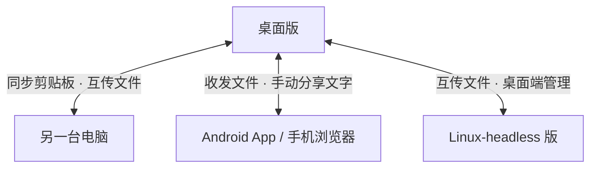
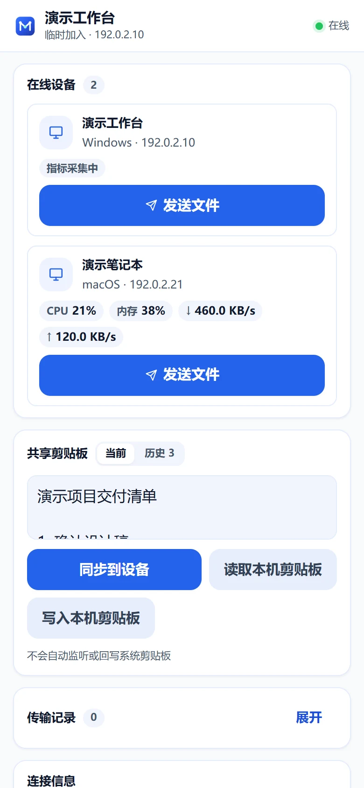

  
  <h1>MeshShare</h1>
  
在一台电脑复制，在另一台粘贴。电脑、手机和 Linux 服务器还可以互传文件。

  
通过局域网或 Tailscale 连接设备，无需注册账号，也无需上传到网盘。

  
<a href="https://github.com/yangjinming1062/MeshShare/releases/latest"><strong>下载 MeshShare</strong></a> · <a href="docs/DESIGN.md">使用指南</a>

## 第一次使用

| 设备 | 选择哪个版本 |
| --- | --- |
| Windows、macOS、Linux 电脑 | **桌面版**。Windows 和 Linux 提供 x64 安装包，macOS 提供 Apple 芯片和 Intel 版本。 |
| 无桌面的 Linux 服务器 | **Linux-headless 版**。使用 amd64 的 `.deb`，安装后由 systemd 运行，可从桌面版管理。[安装与管理](docs/DESIGN.md#linux-headless-版) |
| Android 手机 | **Android App**。下载 arm64 APK，需要 Android 10 和系统 WebView 108 或更高版本。 |
| 手机临时收发 | **手机浏览器**。打开桌面版的「浏览器访问」，用手机扫描二维码，无需安装 App。 |

1. 让设备连上同一局域网并运行 MeshShare。对方会自动出现在电脑或 Android App 的「在线设备」中。
2. 试着向列表中的设备发送一个文件。两台电脑都开启剪贴板同步时，也可以复制一段文字，然后到另一台粘贴。

跨局域网的桌面和 Linux-headless 节点可通过 Tailscale 自动发现。[连接设备](docs/DESIGN.md#连接设备)

## 主要功能

- **同步剪贴板**。在电脑之间自动同步文字和图片，在「历史」里查找并恢复之前复制的内容。
- **直接传文件**。把文件或文件夹拖到桌面版的设备卡片。接收方可逐次确认或设置自动接收。手机也能收发文件、手动分享文字。
- **查看硬件指标**。在设备列表查看在线设备提供的 CPU、内存、GPU 和网速。桌面版可用悬浮条查看本机状态。
- **管理远程设备**。在桌面版点击设备名称查看对方的状态，点击齿轮调整设置。桌面版和 Android App 也能连接已开放的远程终端。

节点端口用于局域网或 Tailscale，请勿转发到公网。桌面版的初始配置允许已连接的其他桌面版或 Android App 打开远程终端。命令以目标机器上的系统账户运行。[远程终端权限](docs/DESIGN.md#桌面终端)

## 界面预览

| 桌面版 | 手机浏览器 |
| :---: | :---: |
|  |  |

[使用指南](docs/DESIGN.md) · [源码构建](docs/DEVELOPMENT.md) · [维护导航](AGENTS.md) · [MIT 许可证](LICENSE)
