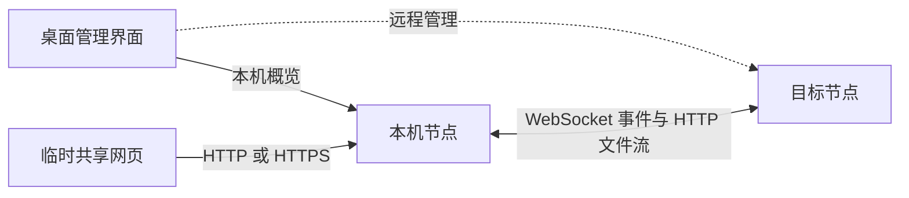

# 节点架构

## 组件与连接

桌面、Android 和 Linux-headless 版各自运行 Rust 节点。桌面与 Android 用 Tauri 提供本机窗口和平台权限，Linux-headless 版由 systemd 管理并提供临时共享网页。桌面切换到远程管理后复用节点业务接口，文件路径、设置和历史都属于当前目标节点。

## 状态归属与恢复

| 状态 | 归属与恢复 |
| --- | --- |
| 剪贴板 | 节点各自保存最新快照和历史。重连交换快照，按事件时钟选取新值。桌面可写入系统剪贴板，Linux-headless 版保存并转发，Android 展示收到的内容。 |
| 连接与指标 | 同一节点的多个地址按节点身份合并，远程管理和上传优先用已连通地址。指标由来源节点采集，接收节点缓存最新值。 |
| 节点直传 | 源节点读取或暂存待发送文件并监督上传。接收节点决定保存位置、校验并提交文件，持有任务状态。界面重载可重新读取进度，节点重启后保留历史，活动任务结束。 |
| 网页传输 | 浏览器持有上传文件和本地目录权限，接入节点持有临时会话与待下载文件。桌面发往本机网页会话的文件在切换远程管理目标后仍可完成上传。 |
| 终端 | 目标节点持有 shell，发起端窗口按标签持有会话。所属节点连接断开时，目标关闭对应的远程终端。 |
| 设置 | 节点将接收目录、历史保留、更新周期等偏好写入本地。桌面壳处理窗口与系统授权，Linux-headless 版从 systemd 读取开机自启状态。 |

## 网络与权限

- **监听范围。** HTTP 和 WebSocket 共用 TCP `37880–37884`。节点启动时优先选择能在回环及当前合规网卡监听的最低端口。没有端口能覆盖全部网卡时，选回环可用且覆盖面最大的端口，覆盖相同取最低端口。回环端口全部不可用时启动失败。运行中按选定端口监听回环、私网、链路本地及 Tailscale IPv4，HTTPS 有独立端口。
- **自动发现。** mDNS 通告所有成功监听的网络地址和实际端口，按节点身份归并多个地址。Tailscale 从本机 CLI 获取在线 IPv4，并在同一端口范围内探测兼容的桌面和 Linux-headless 节点。完成 WebSocket 握手后设备才会显示在线。
- **连接与加密。** 节点间的剪贴板、传输和管理使用明文 HTTP/WebSocket，连接无需账号或令牌。网页 HTTPS 加密浏览器与接入节点之间的连接，客户端需手动信任接入节点的 CA。远程终端使用 SSH 加密，双方校验当前节点连接通告的公钥指纹。
- **本机授权。** 桌面的远程文件访问和入站终端授权由目标电脑的主窗口控制。远程终端只允许其他设备上已连接的原生节点发起，本机终端从主窗口打开。远程文件操作使用目标进程的系统权限，接收文件遵循[传输安全约束](PROTOCOL.md#传输安全约束)。
- **服务权限。** Linux-headless 版的文件访问和终端以专用服务账户运行。具备系统权限的独立助手限于本服务的自启、重启和签名包安装等受控操作。

消息与恢复规则见[节点协议](PROTOCOL.md)，运行时入口见[后端模块](../backend/README.md)。
