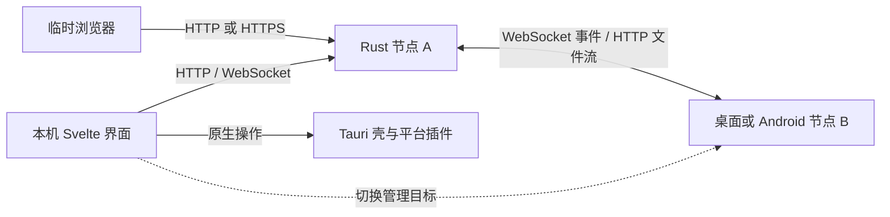

# 节点架构

## 组件与连接

每个节点独立运行，不设主节点。本机界面和远程管理使用同一组业务接口；窗口、托盘、系统对话框与授权交给原生壳。切换管理目标只替换一层上下文，不把目标路径或设置解释为本机数据。

## 状态归属与恢复

| 状态 | 权威与恢复 |
| --- | --- |
| 共享剪贴板 | 各节点维护自己的当前快照与历史。事件按 ID 去重，历史按内容去重，以混合逻辑时钟决定是否替换当前值。新连接交换快照，不合并历史库。 |
| 节点连接 | mDNS、手动地址和桌面 Tailscale 探测提供候选；握手后按节点身份归并。远程管理与上传优先使用已连通端点。 |
| 硬件指标 | 采集方产生快照，接收方按来源更新内存缓存。只保留最新值，断线移除对端；队列拥塞时重新同步快照。 |
| 原生发送 | 桌面对话框或远程目录选择保留原路径，拖放与 Android 使用本机暂存。发送节点监督上传，管理界面不经手远程文件内容。 |
| 接收任务 | 接收节点决定保存目录，持有任务状态并提交文件。界面重载从节点查询；跨进程重启保留终态历史，不恢复活动任务。 |
| 网页文件 | 浏览器上传依赖页面持有的文件；接收依赖接入节点的会话和暂存区。浏览器选择的目录句柄不交给节点。 |
| 交互终端 | 目标桌面节点持有伪终端和 shell。桌面主窗口按标签持有本地会话或 SSH 客户端，Android 主窗口持有远程会话，使用独立的 Tauri Channel 接收有序输出。前端确认消费后继续读取，内存中保留的输出随标签关闭释放。 |
| 系统设置 | 目标节点持久化偏好，目标系统执行自启、更新和监控操作。全屏抑制仅是临时窗口状态，不改用户偏好。 |

## 信任边界

- **监听与发现。** 只绑定回环、RFC1918 私网、链路本地与 Tailscale IPv4。默认 HTTP 端口占用时分配空闲端口；HTTPS 独立监听。网卡变化后重扫，只公布已成功监听的地址，并按新 IP 更新网页证书。桌面 Tailscale 自动发现探测对端默认端口。
- **节点与浏览器。** 节点无账号或令牌；来源过滤不能鉴别同网设备。HTTPS 只保护浏览器到接入节点；本地 CA 私钥以未加密形式保存在节点数据目录，不自动加入系统信任库。
- **终端信任。** 桌面节点信任当前节点网络中其他设备上的原生节点，包括自动发现的设备。终端入口按真实 TCP 来源校验网络范围，拒绝回环及本机各网卡的地址。本机 shell 和旧版授权迁移只由该账号的桌面主窗口通过 IPC 发起。SSH 用当前节点连接通告的指纹校验双方持有的密钥，通过后以目标系统账号启动 shell。主机和客户端各用一把独立的进程内密钥，重启节点时重新生成。
- **文件访问。** 本机暂存接口只允许回环请求。远程目录浏览与按路径发送须在目标本机开启，远程设置不能开启该授权。文件内容由接收方校验后提交，具体约束见[传输协议](PROTOCOL.md#传输安全约束)。
- **平台授权。** macOS 通过 security-scoped bookmark 恢复接收目录权限，失效则回到人工确认。Android 网络适配器在普通全隧道 VPN 下优先绑定可用物理网络，识别 Tailscale 时保留其路由；系统拒绝绑定时回退默认网络。
- **更新安装。** 正式桌面构建用内置公钥验证更新包，安装前再次检查活动传输和桌面终端，并在安装期间暂停接单和新建会话。Android 核对下载大小与 SHA-256，原生安装插件再检查包名、签名证书及版本；重启后以系统安装状态为准。

运行时与落盘细节见[后端模块](../backend/README.md)；消息字段、握手和重试规则见[节点协议](PROTOCOL.md)。
