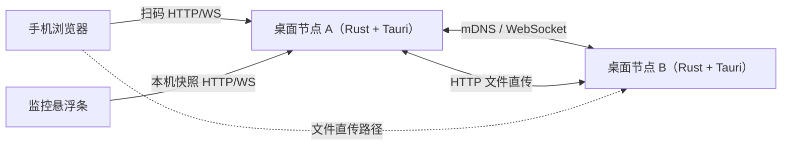
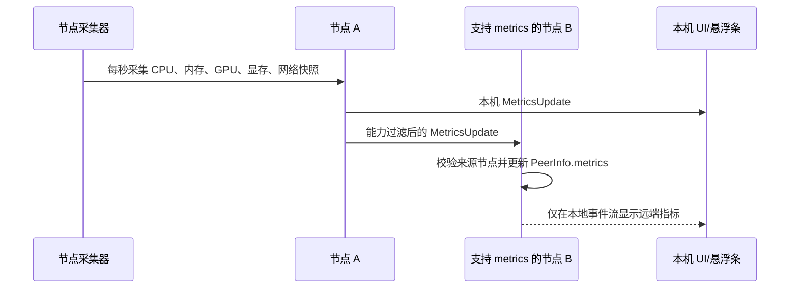
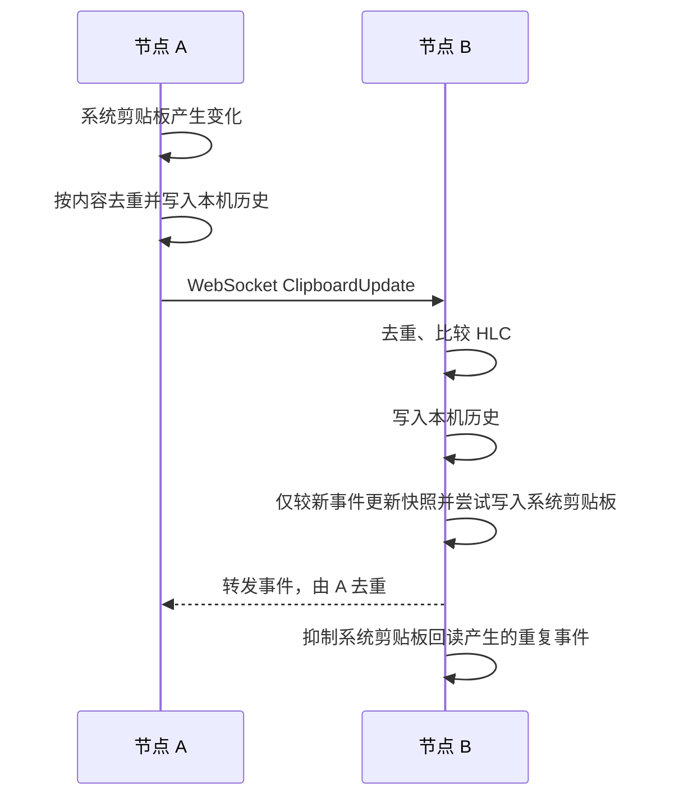
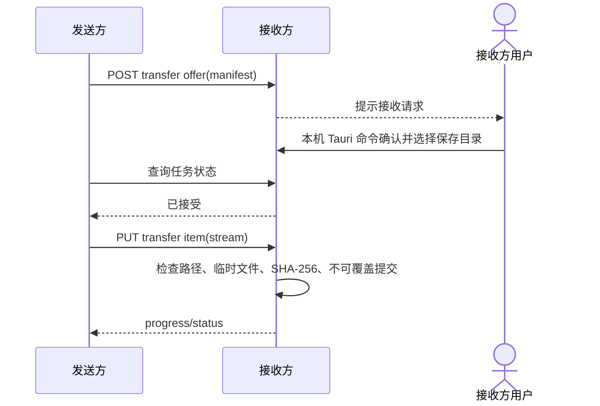
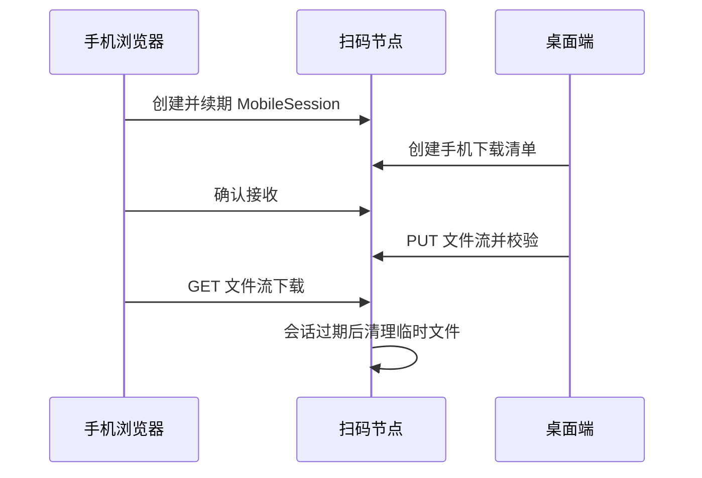

# MeshShare 架构图谱

## 节点拓扑

手机通过可达的桌面节点进入网页，从该节点读取设备列表，也可以选择当前扫码节点作为文件目标。手机建立临时接收会话后，桌面端可把文件发送到扫码节点的临时文件区，手机确认后直接从该节点下载；手机网页发送文件仍使用分块哈希直传。

## 硬件指标同步

指标只保留最新快照。远端超过 5 秒没有更新时标记为过期；GPU/显存读取失败不会影响 CPU、内存和网络指标。

## 剪贴板同步

历史索引保存在各自节点的数据目录，默认按最近 50 条或 30 天保留，桌面端可在 1–500 条和 1–365 天范围内配置。历史不通过 WebSocket 批量同步；新连接仍只交换当前快照。网页读取列表、详情、恢复和清空都通过本机 HTTP API 完成。

## 文件直传

以下是接收方完成确认时的传输流程。任务状态由 Rust 运行时维护，窗口重载后通过任务查询恢复。

手机接收流程使用同一节点的临时文件区：

