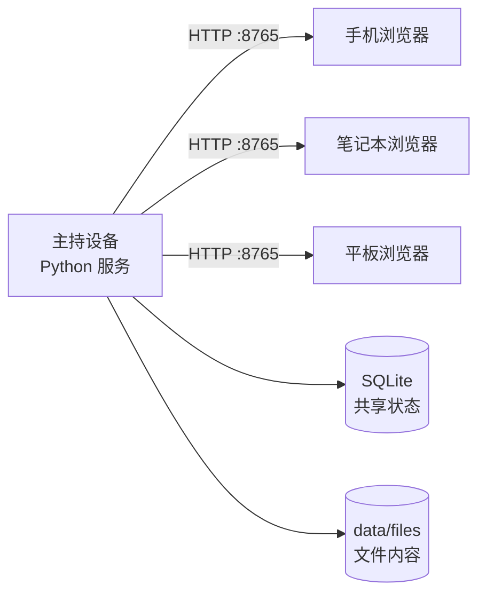
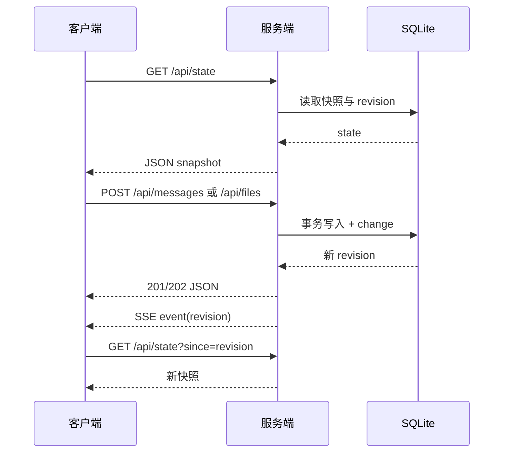

# MeshShare 架构图谱

## 运行拓扑



主持设备和客户端必须在可互通的局域网/VLAN 中。服务只监听局域网接口，客户端不直接互相连接。

## 请求与同步



SSE 连接是通知通道，不是数据存储。服务端重启、代理缓冲或网络切换后，客户端都会回到状态快照。

## 构建与部署

```mermaid
flowchart TD
  P[桌面程序 / python -m meshshare] --> V[校验配置]
  V --> M[创建 data/ 与 schema]
  M --> T[ThreadingHTTPServer]
  T --> W[web/ 静态资源]
  T --> API[/api/*]
  API --> S[Service]
  S --> DB[(SQLite)]
  S --> F[data/files]
```

无前端构建产物和第三方运行时依赖；发布包只需 Python 源码、`web/` 和空的数据目录。
