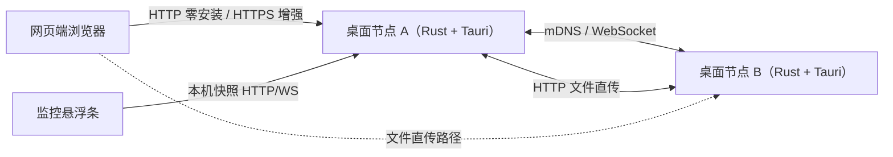
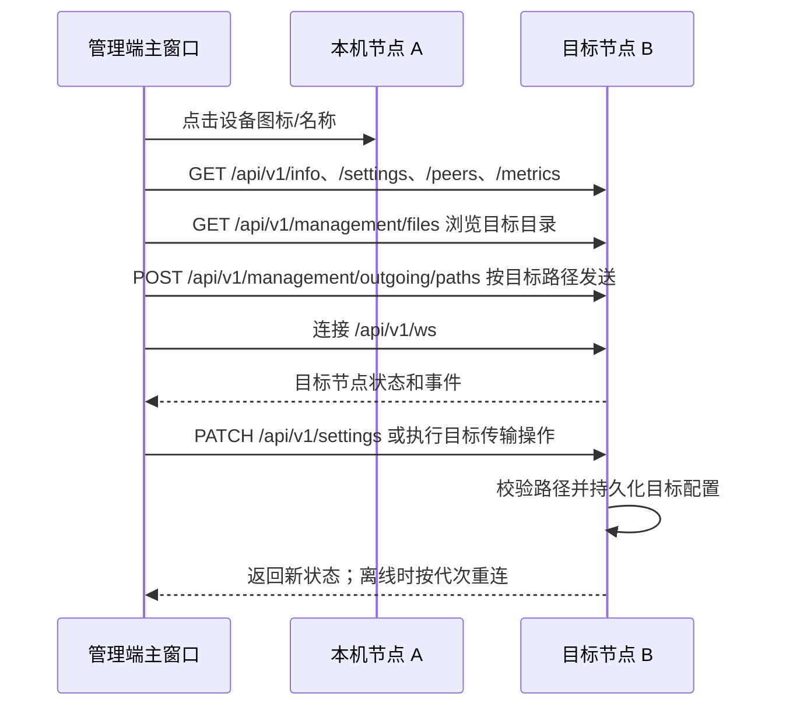
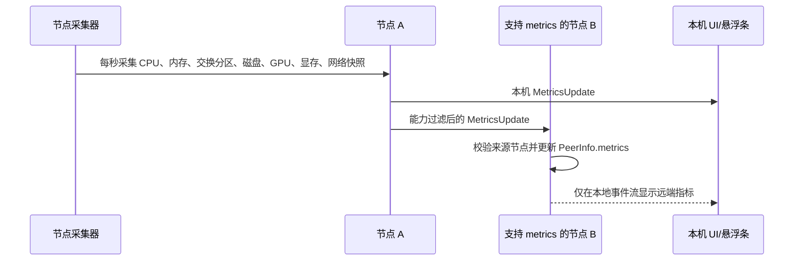
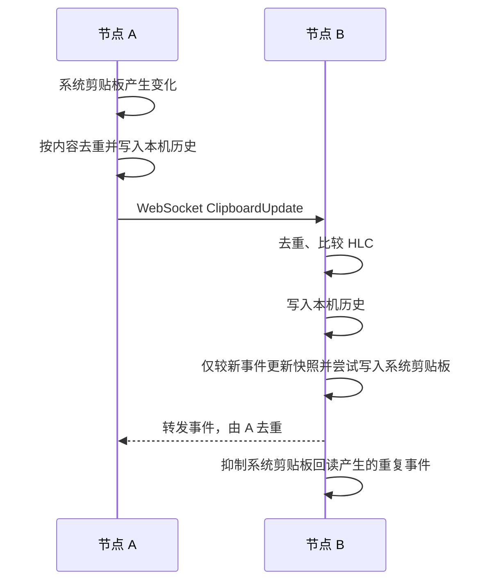
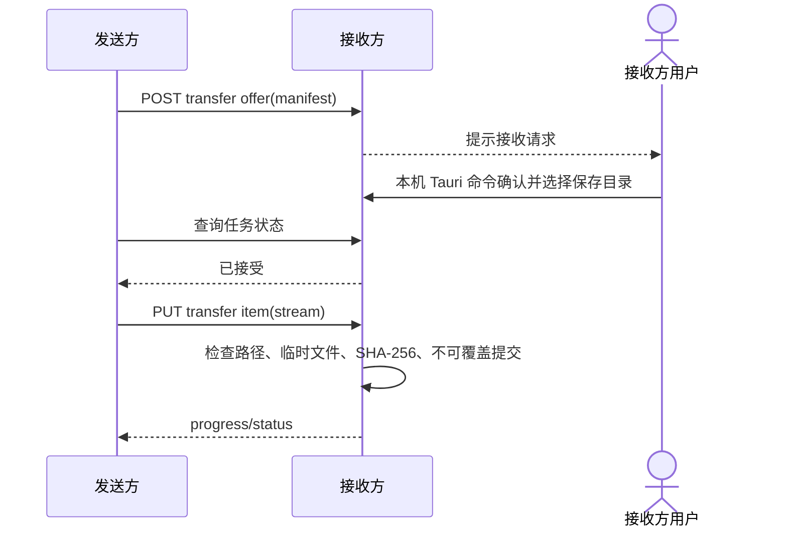
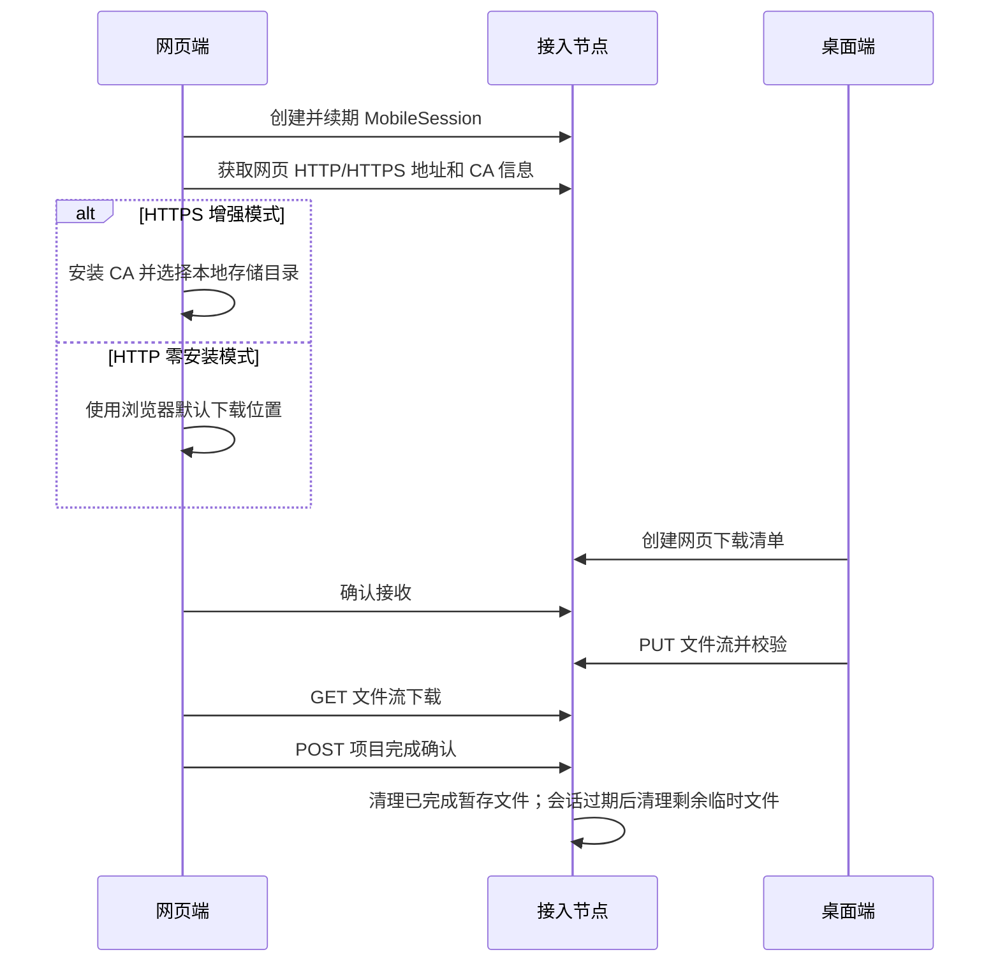
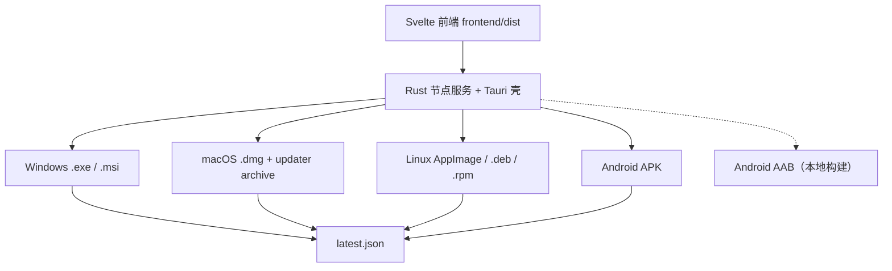

# MeshShare 架构图谱

## 节点拓扑

网页通过可达的桌面节点进入，从该节点读取设备列表，也可以把接入节点选为文件目标。HTTP 页面把文件下载到浏览器默认位置；安装节点 CA 并打开 HTTPS 页面后，可选择本地目录并逐项流式写入。

## 远程管理上下文

切换目标只改变 UI 上下文，不转移状态权威，也不累计层级；返回本机时重新使用 A 的本地 API 和 Tauri 命令。目标更新或重启后保留目标标识，并恢复轮询与 WebSocket。远程发送时管理端只浏览 B 的目录并提交路径，B 读取原文件、计算摘要并发送；该能力要求 B 本机开启远程文件访问。

## 硬件指标同步

指标只保留最新快照，远端超过 5 秒没有更新时标记过期；GPU 或平台不支持的扩展指标读取失败不影响 CPU、内存和网络指标。

## 剪贴板同步

历史只保存在各自节点，不通过 WebSocket 批量同步；新连接仍只交换当前快照。网页读取列表、详情、恢复和清空都通过接入节点的 HTTP API 完成。

## 文件直传

任务状态由 Rust 运行时维护，窗口重载后通过任务查询恢复。

## 网页接收

网页接收会话只在接入节点上有效，空闲 90 秒后由后台清理任务和临时文件。

## 构建与部署

桌面安装包与 Android APK 由同一份前端和 Rust 代码构建；`latest.json` 汇总桌面签名产物和 Android APK 元数据，AAB 只用于应用商店或本地打包。
