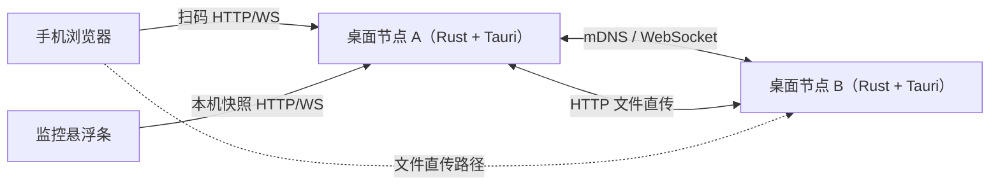
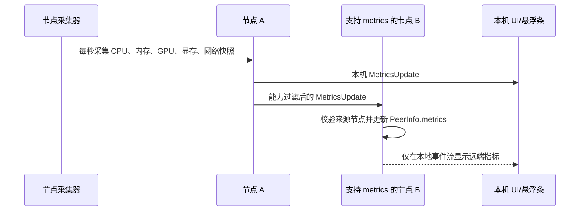
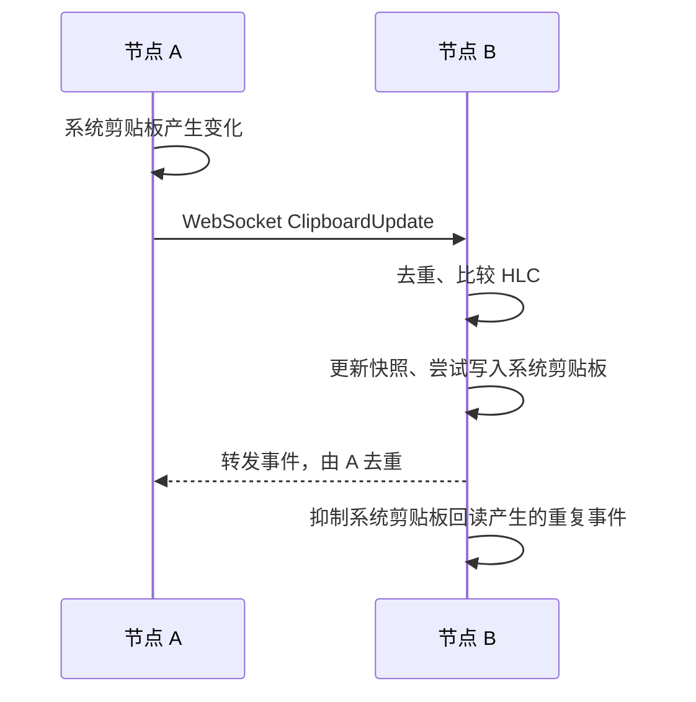
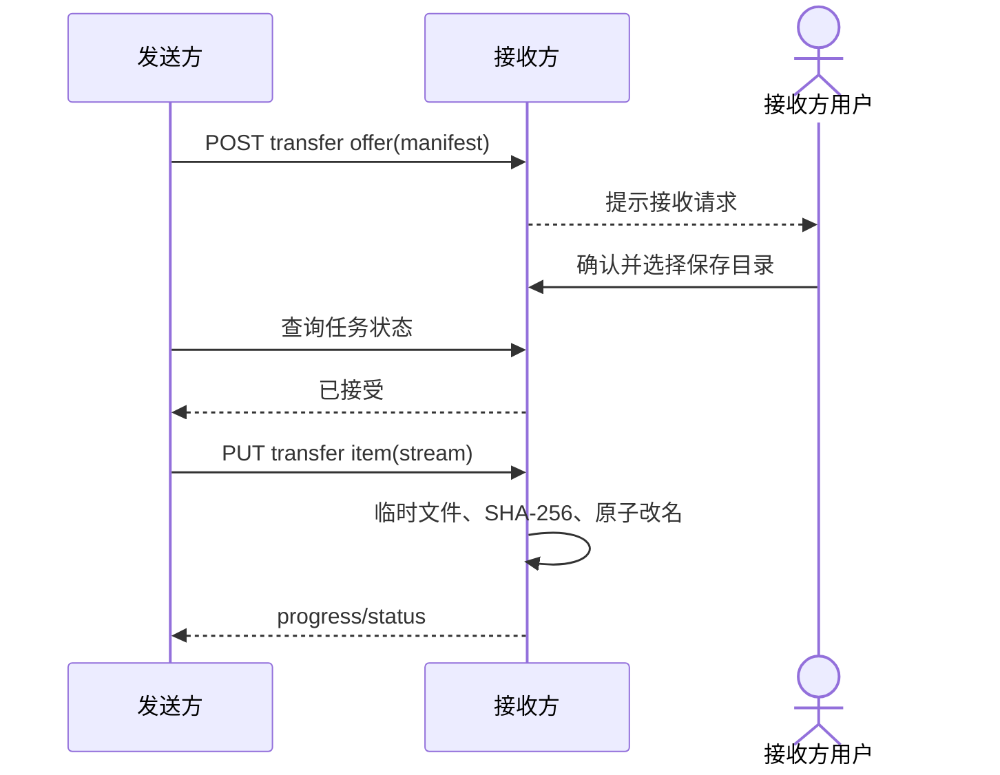

# MeshShare 架构图谱

## 节点拓扑

手机通过可达的桌面节点进入网页，从该节点读取设备列表。文件传输面向目标节点。虚线表示移动端文件发送路径，默认 HTTP 页面会在发起传输前受浏览器安全上下文限制。

## 硬件指标同步

指标只保留最新快照。远端超过 5 秒没有更新时标记为过期；GPU/显存读取失败不会影响 CPU、内存和网络指标。

## 剪贴板同步

## 文件直传

以下是接收方完成确认时的传输流程。当前桌面界面未能正确显示收件确认。

